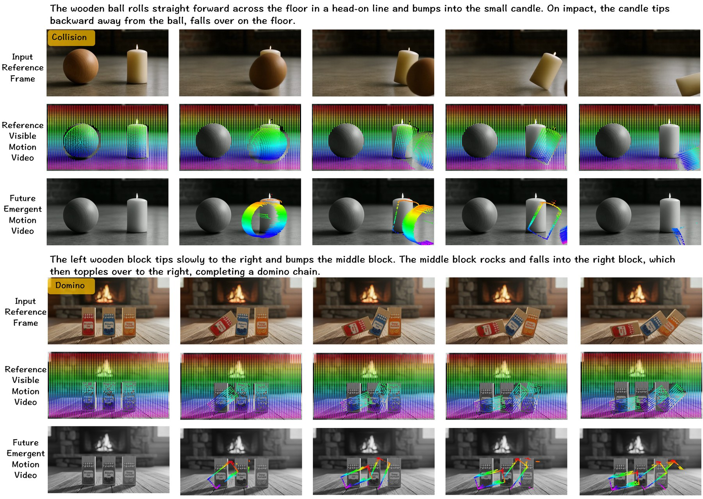
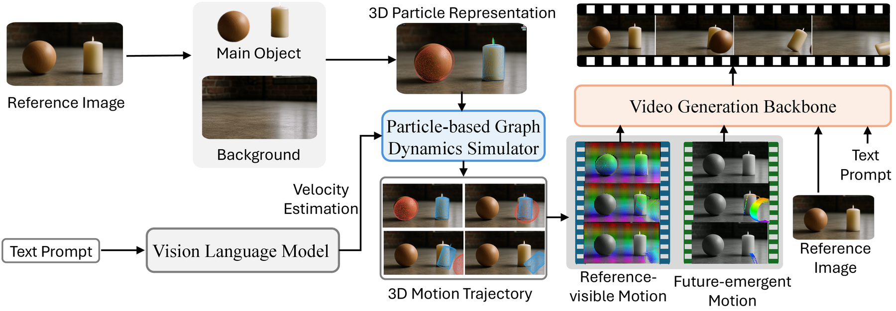
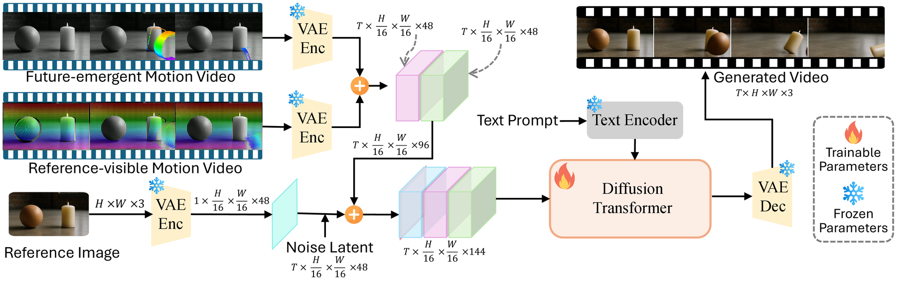
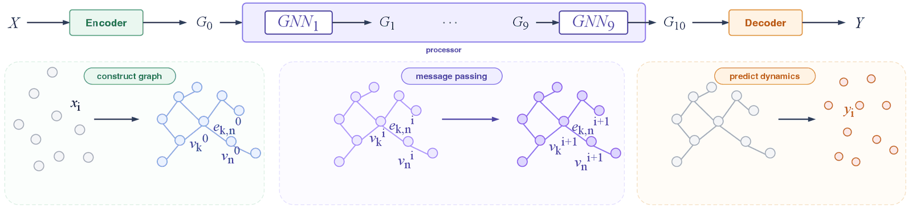
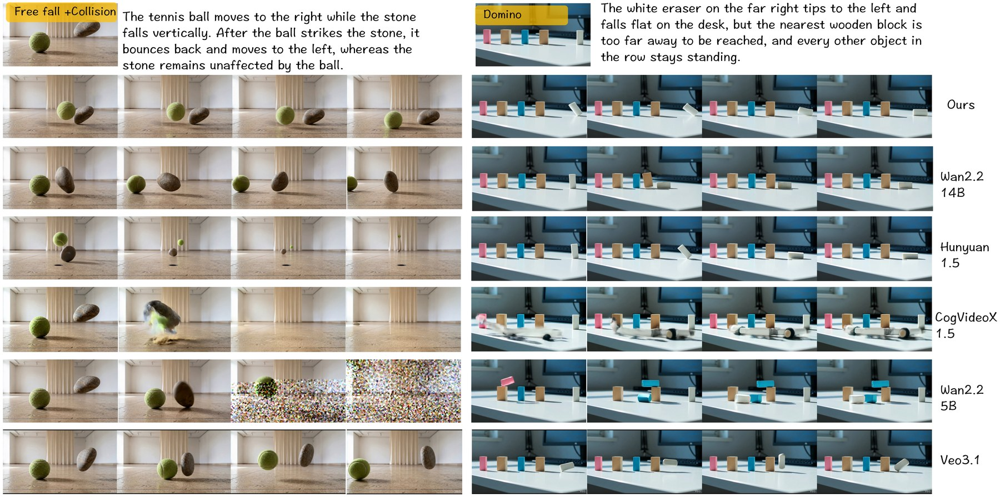
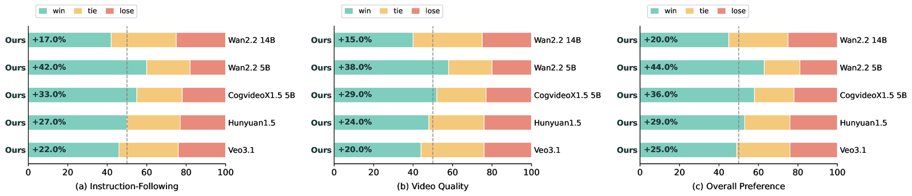

<div align="center">
<h1>Seeing the Unseen: Unified Visible–Invisible Motion<br>for Physically Consistent Video Generation</h1>

<p>
  Mingyang Bao<sup>1</sup> &nbsp;&nbsp;
  Fangda Ye<sup>1</sup> &nbsp;&nbsp;
  Xihao Chen<sup>1</sup> &nbsp;&nbsp;
  Bobo Li<sup>1</sup> &nbsp;&nbsp;
  Jason Li<sup>2</sup> &nbsp;&nbsp;
  Shengqiong Wu<sup>3,✉</sup>
</p>
<p>
  <sup>1</sup>National University of Singapore &nbsp;&nbsp;
  <sup>2</sup>Nanyang Technological University &nbsp;&nbsp;
  <sup>3</sup>University of Oxford
</p>
<p><b>NeurIPS 2026</b></p>

<p>
  <a href="https://vid-gen.github.io/seeing_the_unseen"></a>
  <a href="#"></a>
  <a href="#checkpoints"></a>
  <a href="https://neurips.cc/"></a>
</p>
</div>



**Seeing the Unseen** generates physically consistent videos from a single image. It predicts how the scene
moves with a learned particle simulator, and passes that motion to a video diffusion model as guidance.
The guidance covers motion that is visible in the input frame and motion that only appears later, for
example a candle face that rotates into view after a collision.

- **PGDS** (*Particle-based Graph Dynamics Simulator*) is a lightweight graph network trained on Physion.
  It predicts 3D particle trajectories for collisions, domino chains, free fall and their combinations.
- **VIMF** (*Visible–Invisible Motion Field*) encodes the simulated motion as two tracking videos.
  The *reference-visible* video covers points seen in the first frame. The *future-emergent* video covers
  points that become visible later.
- The two motion videos condition a fine-tuned **Wan2.2-TI2V-5B** through zero-initialized channel injection.
  On seven physical scenarios our method obtains the best Semantic Adherence and Physical Commonsense scores
  against open-source, physics-aware and closed-source models, including Veo 3.1 and Wan-2.7.

## 🔥 News

- **2026.10** Code for all five modules is released. Checkpoints will follow on Hugging Face.
- *Seeing the Unseen* is accepted to **NeurIPS 2026**.

## Method

<p align="center">
  
</p>

The input image is lifted into a 3D particle scene, using SAM3 segmentation, SAM-3D-Objects reconstruction
and voxelization. A vision-language model estimates the initial velocities from the text prompt. PGDS then
rolls out the particle dynamics. The resulting 3D trajectories are rendered into the reference-visible and
future-emergent motion videos, which guide the video generation backbone.

<p align="center">
  
</p>

Both motion videos are encoded by the frozen 3D VAE and concatenated with the noisy video latent along the
channel axis. The new input channels are zero-initialized, so training starts from the unmodified pretrained
model and adds the motion guidance gradually.

<details>
<summary><b>PGDS architecture</b></summary>
<p align="center">
  
</p>
</details>

## Visual Results

### Comparison with Baselines

<p align="center">
  
</p>

## Quantitative Results

Semantic Adherence (**SA**) measures whether the video follows the prompt, including force direction and
contact location. Physical Commonsense (**PC**) measures whether the motion is physically plausible.
Both use a 1–5 scale, higher is better. "–" marks a scenario the method does not support.

<table align="center">
<thead>
<tr><th rowspan="2" align="left">Method</th><th colspan="2">Domino</th><th colspan="2">Collision</th><th colspan="2">Free Fall</th><th colspan="2">Coll.+Dom.</th><th colspan="2">F.F.+Dom.</th><th colspan="2">F.F.+Coll.</th><th colspan="2">Translation</th></tr>
<tr><th>SA</th><th>PC</th><th>SA</th><th>PC</th><th>SA</th><th>PC</th><th>SA</th><th>PC</th><th>SA</th><th>PC</th><th>SA</th><th>PC</th><th>SA</th><th>PC</th></tr>
</thead>
<tbody>
<tr><td colspan="15" align="center"><i>Open-source models</i></td></tr>
<tr><td>Wan2.2-I2V-14B</td><td align="center">2.483</td><td align="center">3.017</td><td align="center">2.750</td><td align="center">3.083</td><td align="center">2.317</td><td align="center">3.033</td><td align="center">2.217</td><td align="center">3.050</td><td align="center">2.533</td><td align="center">2.950</td><td align="center">2.517</td><td align="center">3.000</td><td align="center">3.000</td><td align="center">4.000</td></tr>
<tr><td>Wan2.2-TI2V-5B</td><td align="center">2.650</td><td align="center">3.033</td><td align="center">2.917</td><td align="center">3.067</td><td align="center">2.183</td><td align="center">3.083</td><td align="center">2.200</td><td align="center">3.033</td><td align="center">2.467</td><td align="center">3.033</td><td align="center">2.183</td><td align="center">3.083</td><td align="center">3.000</td><td align="center">4.100</td></tr>
<tr><td>HunyuanVideo-1.5</td><td align="center">2.550</td><td align="center">3.017</td><td align="center">2.867</td><td align="center">3.067</td><td align="center">2.317</td><td align="center">3.017</td><td align="center">2.233</td><td align="center">3.000</td><td align="center">2.617</td><td align="center">2.950</td><td align="center">2.467</td><td align="center">3.000</td><td align="center">3.050</td><td align="center">3.933</td></tr>
<tr><td>CogVideoX1.5-5B</td><td align="center">2.450</td><td align="center">3.200</td><td align="center">2.833</td><td align="center">3.017</td><td align="center">2.333</td><td align="center">3.000</td><td align="center">2.300</td><td align="center">2.983</td><td align="center">2.650</td><td align="center">3.000</td><td align="center">2.333</td><td align="center">3.000</td><td align="center">3.050</td><td align="center">3.933</td></tr>
<tr><td colspan="15" align="center"><i>Physics-aware models</i></td></tr>
<tr><td>PhysT2V</td><td align="center">2.267</td><td align="center">3.867</td><td align="center">2.533</td><td align="center">3.400</td><td align="center">2.050</td><td align="center">4.283</td><td align="center">2.283</td><td align="center">3.267</td><td align="center">2.383</td><td align="center">3.333</td><td align="center">2.117</td><td align="center">3.933</td><td align="center">3.033</td><td align="center">4.400</td></tr>
<tr><td>NewtonGen</td><td align="center">–</td><td align="center">–</td><td align="center">–</td><td align="center">–</td><td align="center">–</td><td align="center">–</td><td align="center">–</td><td align="center">–</td><td align="center">–</td><td align="center">–</td><td align="center">–</td><td align="center">–</td><td align="center">3.033</td><td align="center">3.983</td></tr>
<tr><td>PhysCtrl</td><td align="center">–</td><td align="center">–</td><td align="center">–</td><td align="center">–</td><td align="center">–</td><td align="center">–</td><td align="center">–</td><td align="center">–</td><td align="center">–</td><td align="center">–</td><td align="center">–</td><td align="center">–</td><td align="center">2.867</td><td align="center">4.567</td></tr>
<tr><td colspan="15" align="center"><i>Closed-source models</i></td></tr>
<tr><td>Wan-2.7</td><td align="center">2.200</td><td align="center">2.800</td><td align="center">2.800</td><td align="center">3.000</td><td align="center">2.400</td><td align="center">3.000</td><td align="center">2.200</td><td align="center">3.000</td><td align="center">2.400</td><td align="center">2.800</td><td align="center">2.200</td><td align="center">3.000</td><td align="center">3.000</td><td align="center"><b>4.600</b></td></tr>
<tr><td>Veo 3.1</td><td align="center">2.800</td><td align="center">3.000</td><td align="center">2.800</td><td align="center">3.000</td><td align="center">2.400</td><td align="center">3.000</td><td align="center">2.400</td><td align="center">3.000</td><td align="center">2.800</td><td align="center">3.000</td><td align="center">2.200</td><td align="center">3.000</td><td align="center">3.200</td><td align="center">4.000</td></tr>
<tr><td><b>Ours</b></td><td align="center"><b>3.976</b></td><td align="center"><b>4.013</b></td><td align="center"><b>4.160</b></td><td align="center"><b>4.394</b></td><td align="center"><b>4.347</b></td><td align="center"><b>4.328</b></td><td align="center"><b>3.854</b></td><td align="center"><b>4.016</b></td><td align="center"><b>3.985</b></td><td align="center"><b>4.017</b></td><td align="center"><b>4.327</b></td><td align="center"><b>4.589</b></td><td align="center"><b>4.013</b></td><td align="center">4.578</td></tr>
</tbody>
</table>

On the compatible VideoPhy2 subset:

| Model | SA ↑ | PC ↑ |
|:--|:-:|:-:|
| CogVideoX-5B | 3.21 | 3.65 |
| Wan2.2-5B | 3.14 | 3.46 |
| Ours (visible-only) | 3.47 | 3.78 |
| **Ours** | **4.01** | **4.13** |

Pairwise human evaluation against baselines (win / tie / lose):

<p align="center">
  
</p>

## Repository Layout

The code is split into five modules. They exchange data only through files on disk, and each module has
its own environment and README.

```text
seeing_the_unseen_code/
├── scene_reconstruction/   # image → 3D particle scene → PGDS rollout (inference entry point)
├── gns_training/           # PGDS training / evaluation (PyG, multi-GPU DDP)
├── scene_to_tracking/      # rollout + meshes → reference-visible / future-emergent motion videos
├── tracking_video/         # the same two motion videos from real videos (training data, SpaTrackerV2)
├── video_generation/       # dual-motion fine-tuning and inference of Wan2.2-TI2V-5B (VideoX-Fun)
└── assets/                 # figures used in this README
```

| Module | Role | Upstream code |
|:--|:--|:--|
| [`scene_reconstruction`](scene_reconstruction/README.md) | Image + prompt → 3D scene → particles → PGDS rollout | [SAM-3D-Objects](https://github.com/facebookresearch/sam-3d-objects) @ `81a8237` + patch |
| [`gns_training`](gns_training/README.md) | Train and evaluate PGDS on Physion | [Physion-particles](https://github.com/htung0101/Physion-particles) @ `5ac002a` |
| [`scene_to_tracking`](scene_to_tracking/README.md) | Render the two motion videos from a rollout (inference time) | – |
| [`tracking_video`](tracking_video/README.md) | Extract the two motion videos from real videos (training data) | [SpaTrackerV2](https://github.com/henry123-boy/SpaTrackerV2) @ `7e12274` + patch |
| [`video_generation`](video_generation/README.md) | Train and run the dual-motion video model | [VideoX-Fun](https://github.com/aigc-apps/VideoX-Fun) @ `54bf97a` + patch |

## Installation

Clone the repository:

```bash
git clone https://github.com/vid-gen/seeing_the_unseen_code.git
cd seeing_the_unseen_code
```

The modules depend on different upstream projects, so we recommend one environment per module.
All of them were tested with Python 3.10 on Linux with NVIDIA GPUs.

| Module | Main dependencies | GPU |
|:--|:--|:--|
| `scene_reconstruction` | SAM-3D-Objects, SAM3 (`transformers>=5`), PyTorch 2.5.1 + CUDA 12.1, `binvox` | ≥ 32 GB |
| `gns_training` | PyTorch 2.6.0 + CUDA 12.4, PyG 2.7.0, `torch_scatter` | 1–4 GPUs |
| `scene_to_tracking` | numpy, scipy, trimesh, OpenCV, imageio-ffmpeg | CPU only |
| `tracking_video` | SpaTrackerV2 requirements, PyTorch 2.4.1 + CUDA 12.1, `ffmpeg` | 1+ GPUs |
| `video_generation` | VideoX-Fun requirements, PyTorch 2.5.1 + CUDA 12.4, diffusers 0.37 | 1–2 GPUs for inference, 2 × H200 for training |

Step-by-step instructions, including the upstream checkout and `git apply` of our patches, are in each
module README.

## Checkpoints

| Model | Used by | Size | Download |
|:--|:--|:-:|:--|
| PGDS (`without_Drape/best_model.pth`) | `scene_reconstruction`, `gns_training` | 6 MB | Hugging Face (coming soon) |
| Dual-motion Wan2.2-TI2V-5B transformer (`checkpoint-10500`) | `video_generation` | 10 GB | Hugging Face (coming soon) |
| Wan2.2-TI2V-5B base model | `video_generation` | – | [Wan-AI/Wan2.2-TI2V-5B](https://huggingface.co/Wan-AI/Wan2.2-TI2V-5B) |

Place the downloaded weights under `checkpoints/`:

```text
checkpoints/
├── gns/without_Drape/best_model.pth
└── video_generation/checkpoint-10500/transformer/
```

## 1. Inference: Image → Physically Consistent Video

**Step 1. Reconstruct the scene and simulate it with PGDS.**

```bash
cd scene_reconstruction
export OPENAI_API_KEY=...   # VLM object detection and velocity estimation (or use --no-gpt)
python pipeline_3dgs_to_physics.py \
  --image input.png -o out/scene \
  --motion-prompt "The wooden ball rolls forward and knocks the candle over."
```

**Step 2. Render the reference-visible and future-emergent motion videos.**

```bash
cd ../scene_to_tracking
python generate_tracking_videos.py --data_dir ../scene_reconstruction/out/scene
```

**Step 3. Generate the video.** Run from the VideoX-Fun checkout prepared as described in
[`video_generation/README.md`](video_generation/README.md).

```bash
cd /path/to/VideoX-Fun
S=/path/to/seeing_the_unseen_code/scene_reconstruction/out/scene
python examples/wan2.2_fun/predict_dual_control.py \
  --base_model_path /path/to/Wan2.2-TI2V-5B \
  --config_path config/wan2.2/wan_dual_control_5b.yaml \
  --transformer_path /path/to/seeing_the_unseen_code/checkpoints/video_generation/checkpoint-10500 \
  --tracking_video_1 $S/visible_tracking_das.mp4 \
  --tracking_video_2 $S/future_visible_tracking_das.mp4 \
  --start_image $S/first_frame_1280x704.png \
  --prompt "The wooden ball rolls forward and knocks the candle over." \
  --guidance_scale 3.0 --num_inference_steps 30 --seed 2048 \
  --output_path outputs/scene.mp4
```

`--guidance_scale 1.0` disables classifier-free guidance, so each step needs one forward pass instead of two.

## 2. Training

**PGDS.** Preprocess the Physion training data and train on seven rigid-body scenarios with 4 GPUs.
See [`gns_training/README.md`](gns_training/README.md).

```bash
cd gns_training
bash scripts/train_4gpu.sh <DATA_ROOT>
```

**Motion videos for training data.** Extract the reference-visible and future-emergent videos from
MiraData clips with SpaTrackerV2. See [`tracking_video/README.md`](tracking_video/README.md).

```bash
SPATRACKER_ROOT=/path/to/SpaTrackerV2 DATA_DIR=/path/to/videos OUTPUT_DIR=/path/to/tracking \
  bash tracking_video/scripts/run_batch.sh
```

**Dual-motion video model.** Fine-tune Wan2.2-TI2V-5B on the MiraData videos and their motion videos.
Run from the VideoX-Fun checkout, see [`video_generation/README.md`](video_generation/README.md).

```bash
cd /path/to/VideoX-Fun
bash scripts/wan2.2_fun/train_dual_control.sh \
  --model_dir /path/to/Wan2.2-TI2V-5B \
  --data_root /path/to/miradata \
  --train_meta /path/to/miradata/metadata_dual_control_4999.json
```

## Acknowledgements

This codebase builds on
[SAM-3D-Objects](https://github.com/facebookresearch/sam-3d-objects),
[SAM3](https://huggingface.co/facebook/sam3),
[Physion](https://github.com/cogtoolslab/physics-benchmarking-neurips2021) and
[Physion-particles](https://github.com/htung0101/Physion-particles),
[SpaTrackerV2](https://github.com/henry123-boy/SpaTrackerV2),
[Diffusion as Shader](https://github.com/IGL-HKUST/DiffusionAsShader),
[VideoX-Fun](https://github.com/aigc-apps/VideoX-Fun),
[Wan2.2](https://github.com/Wan-Video/Wan2.2) and
[MiraData](https://github.com/mira-space/MiraData).
We thank the authors for making their work publicly available.

## Citation

If you find this work useful, please cite:

```bibtex
@inproceedings{bao2026seeing,
  title     = {Seeing the Unseen: Unified Visible--Invisible Motion for Physically Consistent Video Generation},
  author    = {Bao, Mingyang and Ye, Fangda and Chen, Xihao and Li, Bobo and Li, Jason and Wu, Shengqiong},
  booktitle = {Advances in Neural Information Processing Systems (NeurIPS)},
  year      = {2026}
}
```

## License

The license is to be announced. `binvox_rw.py`, used by `scene_reconstruction` and `gns_training`, is
distributed under GPL-3.0. Upstream projects keep their own licenses.
